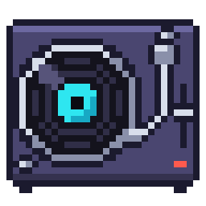

# odecs



Native Odin media codecs and containers: video, audio and image decoding and
encoding with no FFmpeg or other codec library at runtime. Hardware video
coding goes through Vulkan Video on Linux and VideoToolbox on macOS, with the
native codecs as the software path. MIT licensed ([LICENSE](LICENSE)).

## Packages

Video:
- `codec/h264/{encoder,decoder}`: H.264, progressive 8-bit 4:2:0, with encoder checkpoints for editing ([README](codec/h264/README.md)).
- `codec/h265/{encoder,decoder}`: H.265 Main, Main 10 and range extensions; HEVC with an alpha layer, encoded and decoded ([README](codec/h265/README.md)).
- `codec/prores/decoder`: Apple ProRes 422 and 4444/XQ with alpha ([README](codec/prores/README.md)).
- `codec/vp9/{encoder,decoder}`: VP9 decoding, profiles 0–3 with alpha streams; encoding, profile 0 with alpha ([README](codec/vp9/README.md)).
- `codec/av1`: AV1 syntax for hardware decoding through Vulkan Video ([README](codec/av1/README.md)).

Audio:
- `codec/aac/{encoder,decoder}`: AAC-LC, 1 to 8 channels ([README](codec/aac/README.md)).
- `codec/opus`: Opus decoding (SILK, hybrid, CELT), with loss concealment, FEC, DTX and surround ([README](codec/opus/README.md)).
- `codec/flac`: FLAC decoding, 4 to 32 bits ([README](codec/flac/README.md)).
- `codec/mp3`: MPEG-1/2/2.5 Layer III decoding ([README](codec/mp3/README.md)).

Images:
- `codec/webp`: WebP lossy, lossless, alpha and animation to RGBA8 ([README](codec/webp/README.md)).

Containers:
- `codec/container/mp4`: MP4/MOV reading and writing ([README](codec/container/mp4/README.md)).
- `codec/container/webm`: WebM/Matroska reading, and VP9 WebM writing with alpha ([README](codec/container/webm/README.md)).
- `codec/container/ogg`: Ogg (for Ogg Opus) ([README](codec/container/ogg/README.md)).
- `codec/container/wav`: WAV, RF64 and RIFX ([README](codec/container/wav/README.md)).

Putting them together:
- `codec/media`: one encode/decode API over the native codecs and the hardware ones, choosing what the machine supports ([README](codec/media/README.md)).
- `codec/gpu`: Vulkan Video sessions for H.264, H.265 and AV1 ([README](codec/gpu/README.md)).
- `codec/videotoolbox`: H.264 and HEVC hardware decoding and encoding on macOS ([README](codec/videotoolbox/README.md)).
- `codec/movie`: RGBA or planar frames and `f32` PCM from and to movie files, with frame-accurate seeking; writes MP4 (H.264, H.265, HEVC with alpha) and WebM (VP9, with alpha) ([README](codec/movie/README.md)).
- `viewer`: an SDL3 player for all of the above.

Parallel work runs on the caller's `common.Work_Pool`; the codecs never create
threads of their own.

## Using it

The packages import each other by relative path, so odecs can be vendored
into a project or used as a collection:

```sh
odin build . -collection:deps=path/to/parent-of-odecs
```

```odin
import movie "deps:odecs/codec/movie"

config := movie.default_writer_config(1920, 1080, 30000, 1001)
w: movie.Writer
err := movie.create(&w, "out.mp4", config)
for frame in frames do err = movie.write_frame(&w, frame.rgba, frame.width * 4)
err = movie.finish(&w)
movie.destroy(&w)
```

Each package's README covers its API, limits and how it was verified.

Requirements:
- A recent Odin nightly; odecs is built and tested with `dev-2026-10`.
- For hardware video, a Vulkan driver with Vulkan Video (loaded at runtime;
  without one the native codecs are used) or macOS VideoToolbox.
- The viewer uses `vendor:sdl3`: `odin build viewer -o:speed && ./viewer.bin FILE`.
- The SPIR-V for the compute shaders is committed; `shaders/build.sh`
  rebuilds it with `slangc`.

Unit tests run with `odin test`, for example `odin test codec/vp9/encoder`.
The `tests/` scripts compare odecs with reference decoders and encoders
(FFmpeg, libvpx, libwebp and others); they are development tools and need
those binaries installed.

## Platforms

The native codecs and containers are plain Odin and build for Linux, Windows
and macOS. Hardware video goes through Vulkan Video on Linux (Windows needs
only its Vulkan loader name added) and VideoToolbox on macOS, where H.264 and
HEVC decode and encode in hardware. AV1 decodes only in hardware, through
Vulkan Video.

## Sources and licenses

Some packages are ported from permissively licensed projects (libopus,
libwebp, minimp3, PDMP3, gen2brain/h265, oxideav-h265, Kvazaar, OpenH264). Their
notices are kept beside the code (`codec/*/LICENSE-*.txt`) and
[PROVENANCE.md](PROVENANCE.md) records what came from where. The reference
sources themselves are never committed: `bash tools/fetch_third_party.sh`
fetches them at the commits pinned in
[THIRD_PARTY_REFERENCES.md](THIRD_PARTY_REFERENCES.md). They and the `tests/`
scripts are for development only.

The [`demo/`](demo/README.md) is a script for
[onimite](https://github.com/defnotmid/onimite), an Odin + Lua video
framework built on odecs. It carries its own asset notices in
`demo/LICENSES/` (SIL OFL fonts, an MIT avatar clip).
